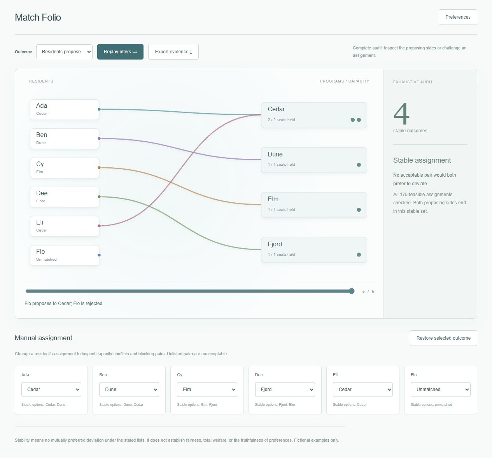

# Match Folio

A stable-matching workbench with program capacities, incomplete preferences, proposal replay, manual assignment challenges, and an exhaustive audit of every feasible small-market outcome.



## Run

```sh
python run.py --port 8000
```

Open http://127.0.0.1:8000. Python 3.10+ serves the app; a browser worker performs the analysis. There are no runtime dependencies or external APIs. Tests use Node 22+.

The fictional example has six residents, four programs, and five seats. It contains 175 feasible assignments and exactly four stable outcomes. Ada/Ben and Cy/Dee can exchange programs between stable alternatives. Eli always matches Cedar and Flo remains unmatched in every stable outcome. Switch the proposing side to see the opposite stable extremes.

The matching board connects resident cards to program cards with curved, color-coded paths. Program seat indicators show held, available, and excess seats. Newly changed matches draw briefly during replay; unchanged diagrams remain in place. Manual assignment controls preserve keyboard focus, and the preference editor opens in a dialog. Reduced-motion preferences disable connection animations.

## Explore

- **Residents propose / Programs propose:** inspect either deferred-acceptance outcome, replay every offer, or scrub the proposal timeline with the keyboard.
- **Stable alternatives:** choose any exhaustively verified outcome, not just the two algorithm endpoints.
- **Manual assignment:** edit individual assignments. The app reports unacceptable matches, over-capacity programs, or concrete blocking pairs with vacant-seat/replacement reasons.
- **Preferences:** edit the JSON market and analyze again. Lists are ordered from best to worst. The editor is a draft; the graph and exports describe the last successful analysis.
- **Evidence:** export the normalized market, both proposal traces, every stable assignment, each resident's possible stable partners, and the currently inspected assignment with its audit.

For a blocking-pair example, start with residents proposing, set Eli to unmatched, then assign Flo to Cedar. Eli and Cedar block that arrangement because Cedar prefers Eli to Flo. Assign Eli back without removing Flo and the result is instead rejected for exceeding Cedar's capacity.

## Model

```json
{
  "residents": [
    { "id": "Ada", "prefs": ["Cedar", "Dune"] },
    { "id": "Ben", "prefs": ["Dune", "Cedar"] }
  ],
  "hospitals": [
    { "id": "Cedar", "capacity": 1, "prefs": ["Ben", "Ada"] },
    { "id": "Dune", "capacity": 1, "prefs": ["Ada", "Ben"] }
  ]
}
```

The JSON field `hospitals` names the program side, following the conventional hospitals/residents model. The complete default is in [docs/example.json](docs/example.json). IDs must be distinct across both sides and contain 1–16 ASCII letters, digits, or underscores. Preferences are strict lists with no duplicates or unknown IDs. Empty lists are allowed; a pair is acceptable only if both list one another. Any acceptable assignment is preferred to being unmatched.

Limits: 1–6 residents, 1–4 programs, capacity 1–3 per program, and a 50,000-code-unit editor limit. Extra object metadata is discarded during normalization. There are no ties, couples, lower quotas, regional constraints, scores, or joint preferences over groups. Program preferences over residents are responsive: a free seat is desirable and a better-ranked resident can replace a worse one.

## Algorithms and interpretation

Resident-proposing deferred acceptance offers in each resident's preference order; programs hold their highest-ranked candidates up to capacity. Program-proposing deferred acceptance fills vacant seats by offering down program lists; residents keep their preferred offer. Each directed proposal occurs once. The first eligible proposer in input order determines replay order. Offers to one-sided unacceptable partners are explicitly declined.

A feasible assignment is stable when no mutually acceptable resident/program pair would both prefer to deviate. A resident must prefer that program to their current match (or be unmatched), and the program must have a vacant seat or prefer the resident to an incumbent. The audit checks feasibility before looking for blocking pairs.

The enumerator explores all unmatched/acceptable choices while enforcing capacities, then tests stability. With these bounds, at most `5^6 = 15,625` complete choice vectors exist before pruning. Every stable result is retained; there is no preview truncation or search budget. The exhaustive approach is intentionally small-scale and exponential. It is not a production matching engine.

Deferred acceptance and proposing-side effects are discussed in [Alvin Roth's review of deferred acceptance algorithms](https://www.nber.org/system/files/working_papers/w13225/w13225.pdf). Here, the exhaustive audit checks the endpoints and alternatives directly. Stability does not imply fairness, maximum total welfare, or that participants reported true preferences. This app is an educational algorithm experiment using fictional inputs, not a tool for making consequential real-world allocation decisions.

## Verification

```sh
node --test
npm run check
python -m unittest discover -s tests -v
```

Seven JavaScript tests cover proposal feasibility, no repeated offers, unacceptable pairs, empty lists, blocking witnesses, capacity errors, and the default four-outcome market. For 200 random markets, a separate base-N assignment enumerator independently checks all stable outcomes, proposing-side bounds on resident ranks, invariant unmatched residents, and program occupancy. A complete six-by-four market checks all 14,565 capacity-feasible assignments and its unique stable outcome. The static-server test checks the allowlist, HEAD responses, and Host restrictions.

Browser verification covered both proposing sides, keyboard scrubbing, complete playback, stable alternatives, manual blocking/capacity challenges, invalid-input recovery, and JSON export. A separate Python enumeration confirmed all 175 default feasible assignments and the same four stable outcomes in the exported evidence. CI covers Linux/Windows and Node 22/24.
